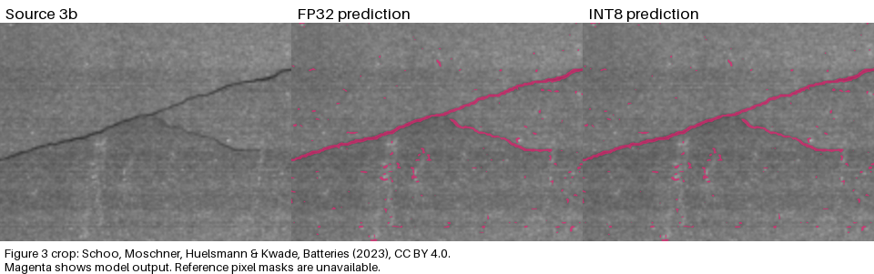
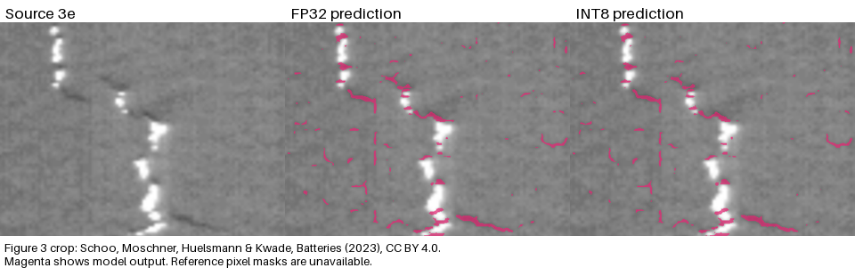

# 锂电极片外部样例

Schoo 等人在连续中试涂布线上用明暗场照明和光学线扫相机采集极片表面图像。其缺陷目录包含 NMC 正极、石墨负极等材料。论文图 3(b) 和 3(e) 分别标为 coating crack 和 mud crack，各分图的具体电极配方未单独注明。[论文及实验方法](https://doi.org/10.3390/batteries9020111)

模型、预处理和判定阈值与主测试相同。左栏是出版图裁块，中、右栏分别叠加 FP32 和 INT8 的预测。模型输入保留图中纹理，裁块避开原版边框、面板字母和标尺。图像经过出版物排版，原始相机文件和像素级真值未提供。

图 3(b) 中，两种模型的预测都沿着可见的暗色主裂纹延伸，背景纹理上也出现零散预测。图 3(e) 中的明亮裂纹两侧出现许多断续响应，同一条亮纹的中部有较长空隙。这两张图用于讨论换材料和光照后的输出表现。准确率、召回率和 Dice 需要独立标注后才能计算。

## 复现

在仓库根目录运行 `python external_check.py`。脚本从出版方读取原图、核对 SHA-256，并检查两份 ONNX 权重与主基准报告是否一致。运行结果保存在本目录。若已有出版方原图，可通过 `--figure` 传入原图路径。

[逐图裁剪坐标、模型校验值与像素判定差异](external.json)。坐标以出版方 3128 × 2796 像素 PNG 的左上角为原点，右下界不包含在裁块中。导出的图片缩放为等比缩略图并添加了模型预测、栏标题和出处。

图像出处为 Alexander Schoo、Robin Moschner、Jens Hülsmann 和 Arno Kwade，*Coating Defects of Lithium-Ion Battery Electrodes and Their Inline Detection and Tracking*，Batteries 9(2), 111 (2023)，Figure 3(b, e)。版权归作者，采用 CC BY 4.0。上述裁切、缩放与叠加由本项目完成。[期刊原图](https://pub.mdpi-res.com/batteries/batteries-09-00111/article_deploy/html/images/batteries-09-00111-g003.png) · [许可条款](https://creativecommons.org/licenses/by/4.0/)
